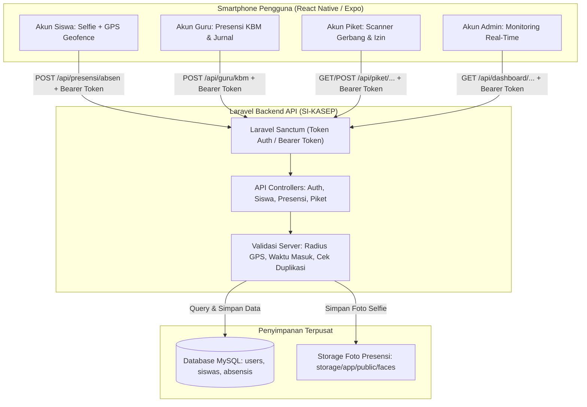
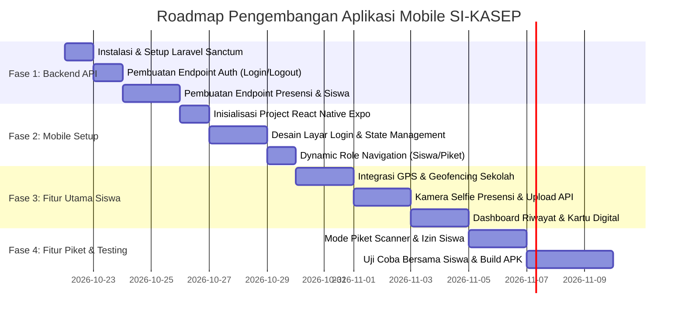

# Rencana Implementasi: Aplikasi Mobile Presensi Siswa (React Native)
**Integrasi Terpusat dengan Backend Laravel SI-KASEP — SMPN 5 Ciamis**

---

## 1. Ringkasan Eksekutif & Tujuan

Saat ini, aplikasi **SI-KASEP** berjalan sebagai Web Application (Laravel). Untuk memberikan pengalaman presensi yang lebih cepat, stabil, dan ramah pengguna di perangkat smartphone, direncanakan pembangunan **Aplikasi Mobile Berbasis React Native** yang terhubung langsung ke database Laravel yang sudah berjalan.

### Sasaran Utama:
1. **Satu Aplikasi untuk Semua Peran (*All-in-One Multi-Role App*)**: Satu aplikasi mobile yang sama diinstal di HP, namun tampilan dan menu otomatis menyesuaikan berdasarkan siapa yang login (**Siswa**, **Guru**, **Piket**, atau **Admin**).
2. **Kamera & Lokasi Native yang Stabil**: Tidak lagi terkendala izin kamera browser yang sering terblokir, tidak terpengaruh masalah HTTPS, dan pemindaian lebih cepat.
3. **Presensi Mandiri Akurat (Anti-Kecurangan)**: Menggabungkan **Selfie Wajah** + **Validasi Radius GPS Sekolah (Geofencing)** agar siswa tidak bisa absen dari luar sekolah.

---

## 2. Arsitektur Sistem & Aliran Data



---

## 3. Matriks Fitur & Navigasi Mobile (100% Mengikuti Menu Web)

Aplikasi mobile membaca `role` dan atribut `is_wali_kelas` saat login, lalu secara otomatis memuat navigasi menu yang sesuai:

### A. Akun Siswa (`role: siswa`)
* **Beranda / Dashboard**: Profil siswa (Nama, NIS, Kelas), info wali kelas, ringkasan kehadiran bulan ini (Hadir, Sakit, Izin, Alpa), dan 3 nilai terbaru.
* **Rekap Absensi**: Riwayat presensi harian per bulan dan tahun, persentase kehadiran.
* **Rekap Nilai**: Daftar nilai per mata pelajaran, riwayat tugas/ulangan harian/PTS/PAS, status KKM (Tuntas/Remedial), dan rata-rata mapel.
* **Profil Siswa**: Info biodata & tombol ganti password/logout.

### B. Akun Guru Mapel (`role: guru`)
* **Dashboard Guru**: Ringkasan mata pelajaran yang diampu, jumlah kelas, dan aktivitas input penilaian terbaru.
* **Manajemen & Input Nilai**: 
  - Memilih Kelas & Mata Pelajaran.
  - Membuat kegiatan penilaian baru (Tugas, Ulangan Harian, PTS, PAS).
  - Menginput nilai siswa langsung dari HP.
* **Daftar Mapel & KKM**: Melihat daftar KKM mata pelajaran dan bobot penilaian.
* **Profil Guru**: Info biodata & tombol logout.

### C. Akun Tambahan: Wali Kelas (`is_wali_kelas: true`)
Jika Guru tersebut ditugaskan sebagai **Wali Kelas**, aplikasi otomatis memunculkan **2 menu ekstra khusus**:
* 🌟 **Nilai Kelas Binaan**: Melihat rekap nilai seluruh siswa di kelas yang dibinanya (misal: Kelas IX E) untuk seluruh mata pelajaran.
* 🌟 **Rekap Kehadiran Kelas**: Memantau kehadiran harian dan bulanan seluruh siswa di kelas binaannya, serta melihat siapa saja yang sering alpa/sakit.

### D. Akun Petugas Piket (`role: piket`)
* **Scanner Presensi Wajah**: Mode kiosk kamera gerbang/meja piket.
* **Monitoring & Izin Siswa**: Mencatat siswa izin keluar/masuk atau terlambat.
* **Rekap Harian**: Melihat daftar siswa yang sudah dan belum hadir hari ini.

### E. Akun Administrator (`role: admin`)
* **Dashboard Utama**: Statistik menyeluruh (562 siswa, guru, kelas).
* **Data Siswa & Rekap**: Memantau kehadiran seluruh sekolah secara real-time.


---

## 4. Keamanan & Pencegahan Kecurangan (Anti-Fraud)

Jika aplikasi diinstal di masing-masing HP siswa, terdapat risiko kecurangan (titip absen / absen dari rumah). Sistem ini dilengkapi 4 lapis perlindungan:

1. **Geofencing GPS Radius Sekolah**:
   - Titik koordinat gerbang SMPN 5 Ciamis dikunci di server backend (contoh radius aman: 100 meter dari gerbang).
   - Jika koordinat HP siswa di luar radius, tombol presensi otomatis terkunci dengan pesan: *"Anda berada di luar area SMPN 5 Ciamis"*.
2. **Kamera Depan Wajib & Real-time (Anti-Upload Galeri)**:
   - Presensi hanya dapat diambil langsung dari kamera depan HP saat itu juga. Siswa dilarang mengunggah foto dari galeri HP.
3. **Deteksi Fake GPS / Mock Location**:
   - Modul `expo-location` memiliki fitur deteksi apakah koordinat berasal dari aplikasi Fake GPS pihak ketiga.
4. **Pencegahan Double-Absen**:
   - Backend memvalidasi tanggal hari ini. Siswa yang sudah hadir tidak dapat melakukan presensi ulang.

---

## 5. Kebutuhan Teknologi & Library (Stack)

### A. Sisi Frontend Mobile (React Native)
- **Framework**: React Native dengan **Expo** (Workflow Managed — cepat, tanpa instalasi Android Studio yang berat di awal).
- **UI & Icon**: React Native Paper / Tailwind (NativeWind) + `@expo/vector-icons`.
- **Navigasi**: `@react-navigation/native`, `@react-navigation/stack`, `@react-navigation/bottom-tabs`.
- **Kamera**: `expo-camera` (untuk snapshot selfie presensi).
- **Lokasi**: `expo-location` (untuk membaca koordinat GPS perangkat).
- **Penyimpanan Lokal**: `@react-native-async-storage/async-storage` (menyimpan token sesi login).
- **HTTP Client**: `axios` (koneksi REST API ke Laravel).

### B. Sisi Backend (Laravel Saat Ini)
- **Autentikasi API**: **Laravel Sanctum** (token-based authentication).
- **Endpoint API**: Ditambahkan di `routes/api.php` tanpa mengubah struktur web yang sudah ada.
- **Database**: Menggunakan database MySQL yang sama persis (tabel `users`, `siswas`, `absensis`).

---

## 6. Tahapan Rencana Pengerjaan (Step-by-Step Roadmap)



### Rincian Tiap Fase:

#### Fase 1: Persiapan Jalur API di Laravel
- Membuka file `routes/api.php`.
- Membuat `Api/AuthController.php` untuk melayani login:
  ```json
  // Contoh Response POST /api/login:
  {
    "status": "success",
    "token": "1|eXamPleToKen123456",
    "user": {
      "id": 12,
      "name": "Budi Santoso",
      "username": "0081234567",
      "role": "siswa",
      "siswa": {
        "id": 45,
        "nama": "Budi Santoso",
        "nis": "0081234567",
        "kelas": "IX E"
      }
    }
  }
  ```
- Membuat `Api/PresensiController.php` untuk menerima presensi selfie + GPS.

#### Fase 2: Inisialisasi Aplikasi React Native
- Membuat project Expo: `npx create-expo-app absensi-mobile`.
- Menyusun struktur folder:
  ```text
  absensi-mobile/
  ├── src/
  │   ├── api/            # Konfigurasi Axios & endpoint
  │   ├── components/     # Komponen UI (Card, Button, Header)
  │   ├── navigation/     # Role-based navigator (SiswaNavigator, GuruNavigator, PiketNavigator)
  │   ├── screens/        # Layar Login, Dashboard, AbsenCamera, Riwayat
  │   └── utils/          # Perhitungan jarak GPS (Haversine formula)
  ```

#### Fase 3: Fitur Utama Siswa (Selfie + GPS)
- Layar presensi memunculkan tampilan kamera depan bulat/oval.
- Aplikasi membaca koordinat GPS:
  - Jika jarak siswa <= 100 meter dari SMPN 5 Ciamis: Tombol hijau *"Ambil Foto & Hadir"*.
  - Jika jarak > 100 meter: Tombol terkunci merah *"Anda Berjarak 2.3 KM dari Sekolah"*.
- Setelah tombol ditekan, foto di-compress dan dikirim via multipart/form-data ke Laravel.

#### Fase 4: Pengujian & Build APK
- Pengujian menggunakan **Expo Go** di HP guru/siswa secara langsung.
- Generate file installer Android standalone (`.apk`) menggunakan perintah:
  ```bash
  npx eas build -p android --profile preview
  ```
- File `.apk` dapat dibagikan langsung ke grup WhatsApp kelas atau di-download dari website sekolah.

---

## 7. Keuntungan Utama Pendekatan Ini

1. **Hemat Biaya & Waktu**: Database, rekap absensi, data siswa, dan modul admin yang sudah ada di Laravel **tidak perlu diubah atau dibuat ulang**.
2. **Kamera Bebas Error**: Tidak ada lagi peringatan browser *"Akses Kamera Ditolak"* karena izin diatur langsung oleh sistem operasi Android/iOS.
3. **Fleksibel**: Sekolah tetap bisa menggunakan web untuk admin/guru di laptop, sementara siswa menggunakan HP untuk presensi harian.
